# CodeLearning - E-learning platform for learning programming with automated code verification in isolated Docker containers

**CodeLearning** is a comprehensive Learning Management System (LMS) designed for programming education. It features a rich course structure (Theory, Video, Quizzes, Coding Problems) and a **secure, isolated Code Runner** capable of executing and grading user code in real-time using Docker containers.

---

## Key Features

### User Roles & Permissions
The system implements Role-Based Access Control (RBAC) to distinguish between content creators and learners:
* **Teacher:** Has exclusive access to the **Creator Studio**. Can create courses, manage chapters, write theory (Markdown), embed YouTube videos, create quizzes and design coding problems with custom test cases. Anyone can register as a teacher; the role separates authoring from learning, it is not a vetted status.
* **Student:** Can enroll in published courses, track progress, solve problems, and receive automated feedback from the runner.

### Learning Experience
* **Rich Content:** Markdown-based theory, embedded YouTube videos, quizzes (single choice, multiple choice, true/false) and coding problems.
* **Structured Learning:** Courses organized into Chapters, Subchapters, and learning Blocks.
* **Progress Tracking:** Detailed tracking of user progress through blocks and chapters.

### Interactive Code Runner
* **Multi-language Support:** At this moment, the system supports Python, C#, Java, JavaScript.
* **Sandboxed Execution:** User code runs in a fresh Docker container per submission, with no network access (`network: none`), a read-only root filesystem and strict resource limits (CPU, RAM, PIDs, file size).
* **High Performance:** The TestRunner agent inside each executor image is compiled with **.NET Native AOT**, so it starts without a .NET runtime and adds little to the container's start-up time.
* **Real-time Feedback:** The result of a submission is pushed to the browser over **SignalR** (WebSockets) as soon as the Runner has graded it, with per-test Input/Output comparison. The page does not poll.

### Security & Architecture
* **Secure Authentication:** JWT-based auth with **HttpOnly Cookies**, Refresh Token Rotation, server-side token blacklisting (Redis), account lockout and rate limiting of login, registration and submissions.
* **Microservices-ready:** Asynchronous communication between the API and the Runner service using **RabbitMQ** via **MassTransit**, with a transactional outbox so no submission is lost between the database and the queue.
* **Layered Architecture:** The backend (.NET) is split into Core (entities and grading rules), Application (service contracts, DTOs, validation), Infrastructure (services, EF Core, Identity, Redis, messaging) and the two hosts, Api and Runner. The frontend (Angular) uses signal-based state management.

---

## Tech Stack

### Backend & DevOps
* **.NET 10:** API & Runner Service.
* **.NET Native AOT:** Used for the `TestRunner` agent (high-performance execution probe).
* **ASP.NET Core Identity + FluentValidation:** User accounts and request validation.
* **xUnit & Testcontainers:** Integration tests against real PostgreSQL and Redis containers.
* **Docker Compose:** Orchestration of the entire stack, with **nginx** serving the frontend and proxying the API.
* **RabbitMQ + MassTransit:** Asynchronous task queue for code execution (quorum queue, retries, transactional outbox).
* **SignalR:** Server push of submission statuses to the browser.
* **Redis:** Refresh tokens and the JWT blacklist.
* **PostgreSQL:** Primary relational database (with JSONB support)

### Frontend
* **Angular 21:** Using modern features like **Signals** and Standalone Components.
* **Monaco Editor:** The code editor that powers VS Code, integrated for a coding experience.
* **Tailwind CSS:** For rapid and responsive UI development.
* **marked + DOMPurify + highlight.js:** Markdown rendering, sanitization and code highlighting.
* **Vitest:** Unit tests.

---

## Architecture

### System Overview
The system splits responsibilities between the REST API (User interaction) and the Execution Worker (Heavy lifting/Code running).

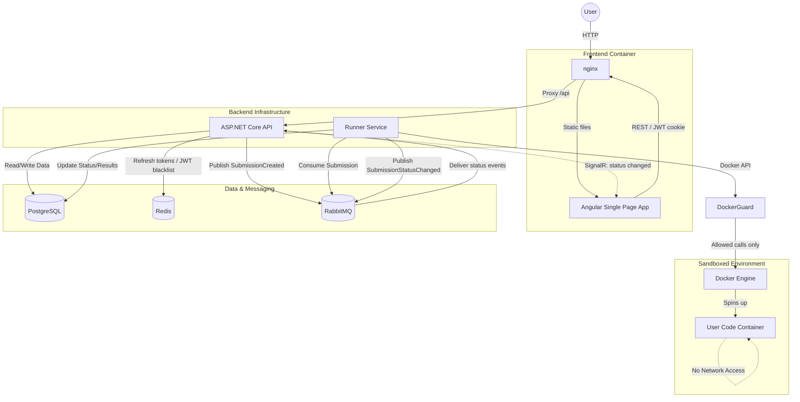

### Course Data Structure (ERD)
The content is organized hierarchically. A `CourseBlock` has a type (Theory, Video, Quiz, Problem) and points at the matching content, so different kinds of content share one ordered list. A problem lives outside the course tree and can be used by several blocks.

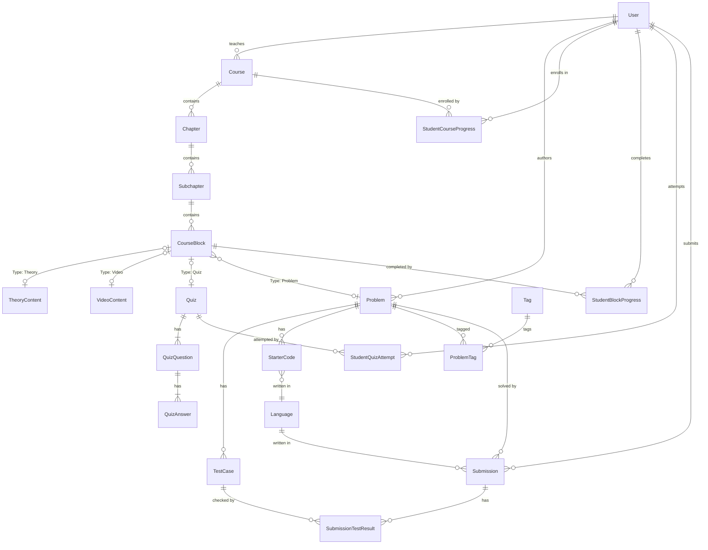

There is no separate enrollment table: a student is enrolled in a course when a `StudentCourseProgress` row exists for the pair. The languages a problem can be solved in are the ones it has a `StarterCode` for.

### Code Execution Pipeline
A detailed look at how a user's code is processed. The `Runner` service starts a fresh container for every submission. It never talks to the Docker socket itself: every call goes through `DockerGuard`, which allows only what the Runner needs (see [Security Measures](#security-measures-xss--sandbox)).

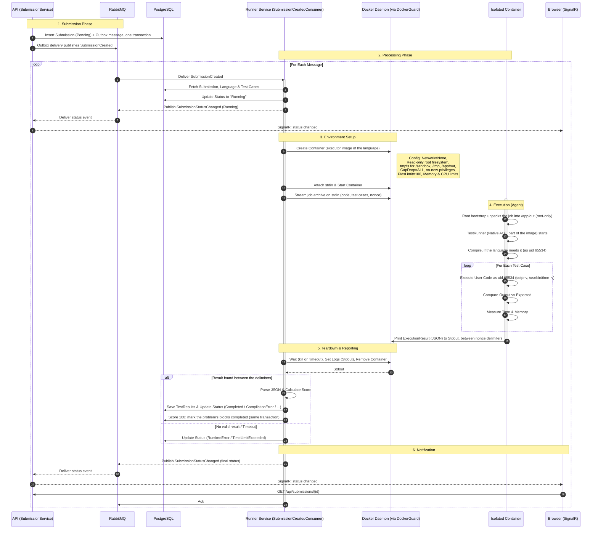

Submissions are delivered at least once. The API saves the submission and the `SubmissionCreated` message in one transaction (MassTransit EF Core outbox), and a background service forwards the message to RabbitMQ, so a broker outage cannot leave a submission without a message. The Runner consumes from the `submissions` quorum queue, at most `MaxConcurrentExecutions` at a time, and acknowledges a message only once its result is stored; if the runner crashes, RabbitMQ redelivers the message. A failed attempt is retried after `RetryDelaySeconds` (5 s), and after `MaxDeliveryAttempts` (3) the message moves to `submissions_error` and a fault consumer marks the submission as failed. A redelivered message whose submission already has a result is acknowledged without running it again. Both the API and the Runner declare the `submissions` queue and bind it to the message exchange at startup, so a submission made before the Runner has ever run waits in the queue instead of being dropped. As a last safety net, the Runner fails any submission that has made no progress for `StuckSubmissionTimeoutMinutes` (30), so nothing stays Pending or Running forever.

### Real-time Status Updates (SignalR)
The Runner is a separate process, so it cannot reach the browser itself. After it has stored a status it publishes a `SubmissionStatusChanged` event; the API consumes it and forwards it through the `SubmissionsHub` (`/api/hubs/submissions`) to the connections of the student who made the submission (`Clients.User`), and to nobody else.

* **The event is a hint, not the result.** It carries only the submission id and status. The page then reads the submission from `GET /api/submissions/{id}`, so the rule that students see only public test cases stays in one place.
* **Authentication** is the same HttpOnly access-token cookie as for the REST API; the hub requires an authenticated user and no token is put in a URL.
* **Transport:** WebSockets, with SignalR's own fallback to Server-Sent Events and long polling. The nginx frontend proxies the upgrade (`location /api/hubs/`).
* **Delivery is best effort by design.** The status event is published after the result is committed, and a failure to publish is only logged: it must never cause the student's code to run again. SignalR does not queue messages for a client that is offline either. The page therefore also reads the submission once right after submitting, after every reconnect, and after 60 s without any event, so a lost event delays the result but never loses it.
* **Scaling out:** each API instance consumes status events from its own temporary queue, so every instance sees every event and notifies the browsers connected to it; no SignalR backplane is needed.

### Authentication Flow (Secure Cookie Strategy)
The system uses a "Silent Refresh" strategy. Tokens are stored in HttpOnly, Secure, SameSite=Strict cookies, making them inaccessible to JavaScript (XSS protection). The access token lives 5 minutes and the refresh token 7 days. The frontend refreshes shortly before the access token expires, and an Interceptor refreshes and retries when a request still gets a 401.

Refresh tokens are kept in Redis as hashes, one per session, and are single-use: a refresh atomically replaces the old token with a new one (rotation), so a replayed token finds nothing. Logging out deletes the session's refresh token and puts the access token's id on a blacklist until it expires.

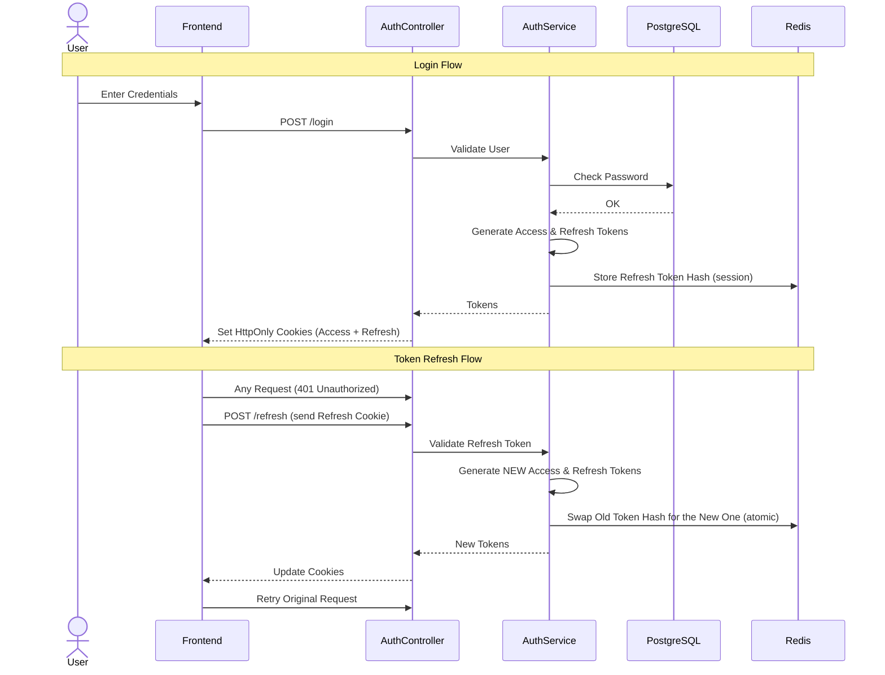

## Screenshots

Here are some screenshots of the application.

### Dashboard

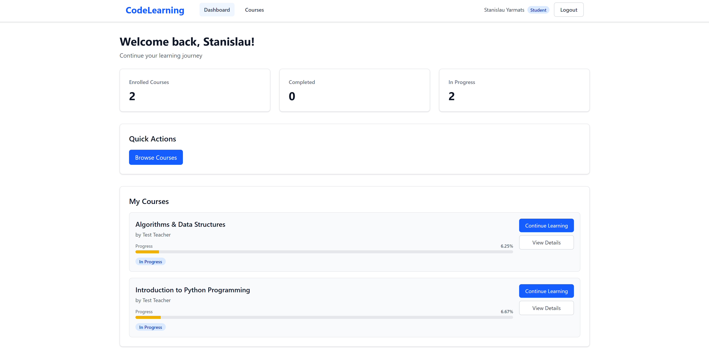

### Course Details
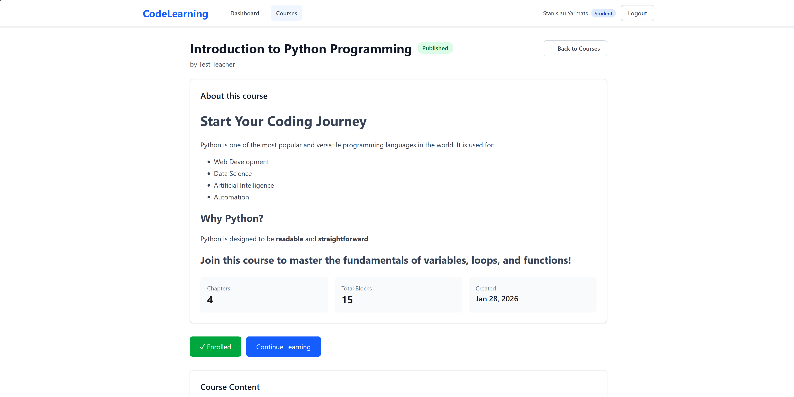

On this page you can also see course content.

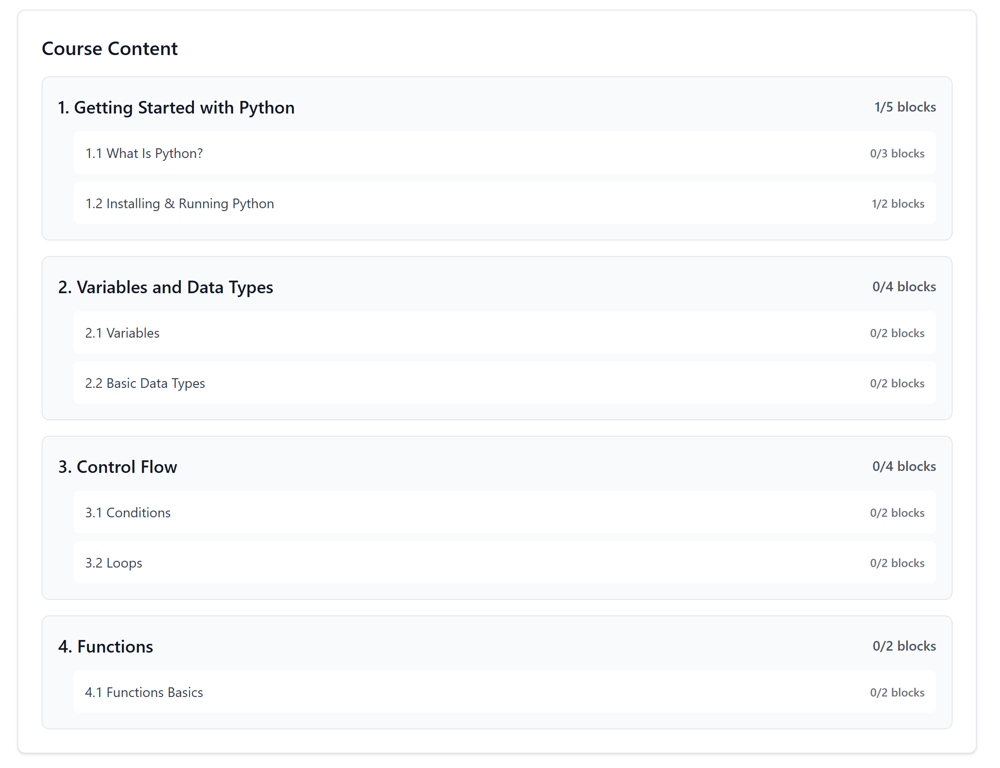

### Problem View

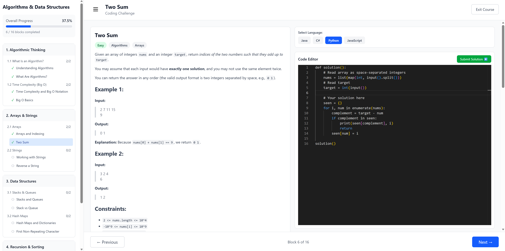

You can see the history of submissions, the score, the submitted source code and so on.

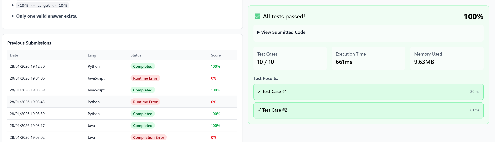

### Theory Block

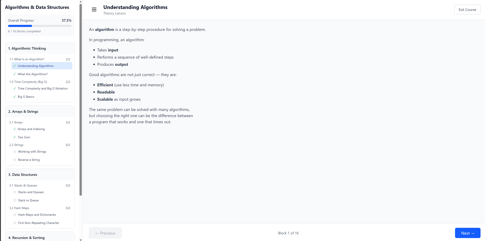

### Video Block

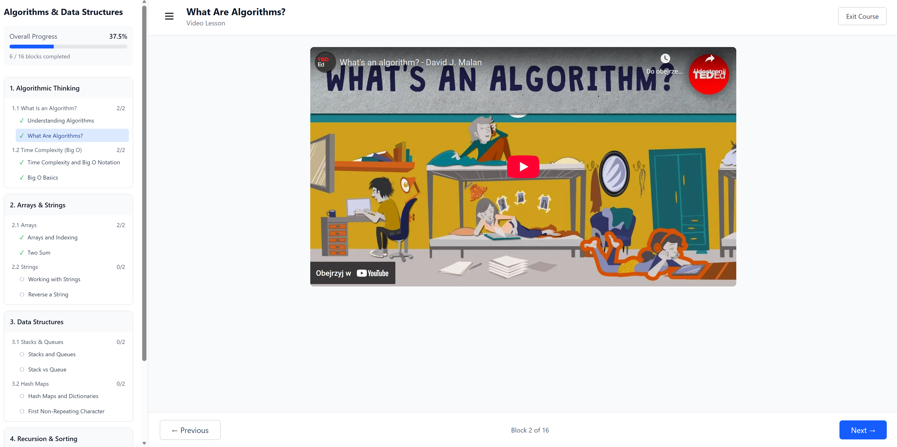

### Quiz Block

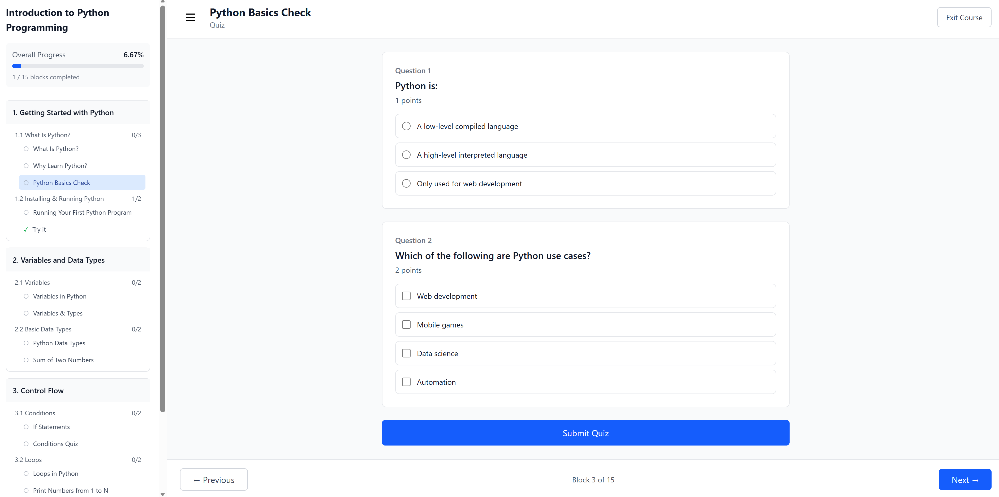

## Getting Started

### Prerequisites
* **Docker Desktop** (or Docker Engine with the Compose plugin) - enough to run the whole application.
* **.NET 10 SDK** - only to run the backend tests or the API outside Docker.
* **Node.js 24 and npm** - only to run the frontend tests or the Angular dev server outside Docker.

### Running

All commands are run from `src/backend/CodeLearning.Backend`.

**1. Create the configuration.** Copy `.env.example` to `.env` and fill in the required values (database, Redis and RabbitMQ credentials, a JWT signing key of at least 32 random characters). `DOCKER_SOCKET_GID` is `0` on Docker Desktop; on Docker Engine it is the output of `stat -c %g /var/run/docker.sock`. Compose refuses to start while a required value is missing.

**2. Build the executor images.** These are the images student code runs in; they are only built, never started by Compose:

`docker compose -f docker-compose.yml --profile executors build`

**3. Start the stack.**

`docker compose -f docker-compose.yml up --build -d`

The application is on `http://localhost:4200` (nginx serving the built frontend and proxying `/api` to the API). The database schema is created on the first start. The only seeded data are the four languages and the problem tags, so start by registering a teacher account and creating a course.

To stop it: `docker compose -f docker-compose.yml down` (add `-v` to delete the data as well).

### Development mode

`docker compose up --build -d` (without `-f`) also applies `docker-compose.override.yml`, which:

* runs the API in the `Development` environment, with Swagger on `http://localhost:5000/swagger` and HTTPS on `https://localhost:5001`. The HTTPS endpoint uses the ASP.NET Core development certificate and user secrets mounted from `%APPDATA%` (the layout Visual Studio's container tools create), so this mode is meant for Windows with that certificate exported;
* replaces nginx with the Angular dev server (live reload) on `http://localhost:4200`;
* publishes PostgreSQL (`5433`), Redis (`6379`) and RabbitMQ (`5672`, management UI on `15672`) on localhost.

Swagger is available in the `Development` environment only.

The frontend can also be run on its own against an API on `https://localhost:5001`:

`cd src/frontend/codelearning-frontend`, then `npm install` and `npm start`.

## Running Tests

**Backend** - **xUnit**, with **Testcontainers** starting real PostgreSQL and Redis containers for the integration tests, so Docker has to be running. From `src/backend/CodeLearning.Backend`:

* Everything: `dotnet test CodeLearning.Backend.slnx`
* Without the sandbox tests: `dotnet test CodeLearning.Backend.slnx --filter "Category!=Sandbox"`
* Only the sandbox tests: `dotnet test CodeLearning.Backend.slnx --filter "Category=Sandbox"`

The sandbox tests run real submissions in the executor images, so those have to be built first (step 2 above).

**Frontend** - **Vitest**. From `src/frontend/codelearning-frontend`: `npx ng test --watch=false`

Both suites, the production builds and the Docker images are also built and run by GitHub Actions on every pull request (`.github/workflows`).

## Security Measures (XSS & Sandbox)

- **Markdown sanitization:** Theory, course descriptions and problem statements are stored as the Markdown the teacher wrote. They are sanitized where they become HTML: the frontend renders them with `marked` and passes the result through **DOMPurify** before it reaches the page (`MarkdownService`), so script tags, event handlers and `javascript:` links are removed.

- **Auth:** Tokens are never accessible to JavaScript (`HttpOnly` cookies), are sent over HTTPS only (`Secure`) and never on cross-site requests (`SameSite=Strict`). Login, registration and submissions are rate limited, and accounts lock for 5 minutes after 5 failed logins.

- **Runner Isolation:**

    - **Docker API guard:** the Runner never touches the Docker socket. It talks to `DockerGuard` (`CodeLearning.DockerGuard`), a small proxy that allows only the calls the Runner makes and refuses everything else (exec, build, volumes, networks, copying files in or out, ...):

        - **Container creation is checked field by field.** The image must be one of the executor images, the network must be `none`, the root filesystem must be read-only with size-capped tmpfs mounts for the writable paths, all capabilities must be dropped, only `no-new-privileges` is allowed as a security option, and memory (with no swap), CPU and PID limits are required and capped. The user must be the sandbox user `65534`, or root with nothing added back except `SETUID`, `SETGID` and `KILL`. Any field the guard does not know (privileged mode, host mounts, devices, host namespaces, ...) is refused. The guard forwards a body rebuilt from the checked fields, never the original, so case-variant or duplicate JSON fields cannot slip past it.

        - **Start, wait, kill, logs, inspect, attach and remove work only on sandbox containers.** The guard asks the daemon for the container's labels and requires `codelearning.sandbox=true`, so the database, API and other containers cannot be touched. Listing containers is forced to the same label, and only the executor images can be pulled.

        - The guard itself runs as a non-root user with a read-only filesystem, no capabilities and `no-new-privileges`, on an internal network that only the Runner shares.

    - **Read-only root filesystem.** The only writable places are tmpfs mounts that disappear with the container: `/sandbox` (the submission's workspace, 64 MB), `/tmp` (32 MB) and `/app/out` (32 MB, root-only). They count against the container's memory limit.

    - **The job is streamed in, not copied in.** The code and the test cases arrive as an archive on the container's stdin and are unpacked into the root-only `/app/out`, so the expected outputs are never readable by the submission.

    - **Student code runs as an unprivileged user.** The container starts as root with every capability dropped except `SETUID`/`SETGID` (to switch user) and `KILL` (to stop the submission's processes). Every compile and run command is executed as uid `65534` through `setpriv`, with `no-new-privileges`. The submission can therefore not write the result, read the inputs or signal the agent.

    - **The result cannot be forged.** The agent prints it on stdout between delimiters that carry a per-run random nonce only root can read; the Runner parses nothing else.

    - Memory (no swap), CPU, PID (100, which stops fork bombs), file size (64 MB) and open-file limits.

    - Network is completely disabled for user code.

    - **Limitation:** containers share the host kernel, so a kernel exploit in student code could still escape the container. gVisor closes that gap (see below).

### Running with gVisor (optional, WSL2/Linux)

[gVisor](https://gvisor.dev) runs each executor container on a user-space kernel, so student code never talks to the host kernel directly. Docker Desktop cannot load extra runtimes, so this needs Docker Engine installed directly in a WSL2 distro (or on a Linux host):

1. In WSL, turn on systemd: add `[boot]` / `systemd=true` to `/etc/wsl.conf`, then run `wsl --shutdown` and reopen the distro.
2. Turn off Docker Desktop's WSL integration for that distro, and install Docker Engine from Docker's apt repository.
3. Install gVisor and register it with Docker:
   ```bash
   curl -fsSL https://gvisor.dev/archive.key | sudo gpg --dearmor -o /usr/share/keyrings/gvisor-archive-keyring.gpg
   echo "deb [arch=$(dpkg --print-architecture) signed-by=/usr/share/keyrings/gvisor-archive-keyring.gpg] https://storage.googleapis.com/gvisor/releases release main" | sudo tee /etc/apt/sources.list.d/gvisor.list
   sudo apt-get update && sudo apt-get install -y runsc
   sudo runsc install
   sudo systemctl restart docker
   docker run --rm --runtime=runsc hello-world
   ```
4. Set `ExecutionSettings__ContainerRuntime: runsc` on the `runner` service. `runsc` is already in DockerGuard's `AllowedRuntimes`.

